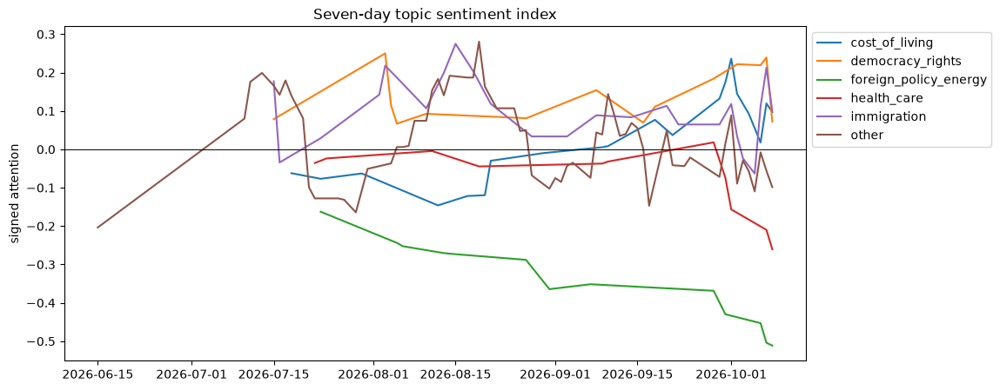
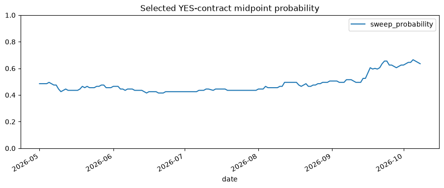

# 2026 midterm voter issues, sentiment, and equities

**As of:** October 8, 2026 (pre-election).

## Executive conclusion

The executed text sample makes immigration the most frequent *predefined* issue label, while external polling still supports a cost-of-living/health-care centered voter-concern hypothesis. The distinction matters: collected-media salience is not representative polling. A recent AP-NORC report says Democrats have gained an advantage on cost of living and health care; a rural-voter AP/KFF poll likewise puts cost of living and health-care costs ahead of immigration. [AP-NORC](https://apnews.com/article/109768f7544c9e0fcc7e716de0dc2157) [AP/KFF rural voter poll](https://apnews.com/article/b03eea8538b024fd02f5fb52e811738b)

The investment conclusion is deliberately narrower. Election-linked sentiment can be a useful *risk monitor*, but neither a topic/sweep correlation nor a basket return establishes that an election outcome caused the return. Policy timing, earnings, rates, oil, and campaign developments all confound it. The notebook reports correlation, a one-day-lag specification, and market-adjusted returns; it does not convert those estimates into a trading recommendation.

## Design

### Text universe and topic discovery

The notebook combines public GDELT article metadata, Google News RSS, Hacker News public search, Mastodon public tag timelines, and twitterapi.io read-only X advanced search. It stores date, source, title/text, and URL, deduplicates text, and never commits raw API output. The X search is capped at three pages because the provider charges for returned posts. A public source is not a random sample of voters; source-specific comparisons are retained so an outlet or platform cannot silently dominate the index.

Primary discovery uses BERTopic (sentence embeddings plus density clustering) when its optional packages are installed. It produces representative words/documents and topic counts for human review. The review paper supplied with the assignment motivates comparing probabilistic and non-probabilistic topic-model families and evaluating topic quality; the notebook therefore includes a transparent seed-label fallback and asks the analyst to inspect topic labels before interpreting them. [Topic-modeling review](https://eudl.eu/doi/10.4108/eai.13-7-2018.159623)

The fallback topics and seed terms are:

| Topic | Interpretation |
|---|---|
| `cost_of_living` | prices, rent, wages, tariffs, inflation |
| `health_care` | coverage, drug prices, Medicare/Medicaid |
| `immigration` | border, deportation, asylum, ICE |
| `democracy_rights` | abortion, voting rights, election integrity |
| `foreign_policy_energy` | Iran/Ukraine/Israel, gasoline, energy |

Each document receives a VADER compound score in the baseline. The preferred notebook branch uses FinBERT if installed, because finance/policy wording can be poorly handled by a general lexicon. Daily topic sentiment is the mean score; a signed, volume-aware attention index equals `mean sentiment × log(1 + mentions)`. Both components are published so a rise in attention cannot be mislabeled as a rise in positivity.

### Prediction-market outcome

“Democratic sweep” means Democratic control of **both** the House and Senate. The notebook first searches active Polymarket Gamma metadata for relevant House/Senate/control contracts, shows the exact question and liquidity, and makes the analyst choose a contract or construct the product of separate House and Senate probabilities. It then downloads CLOB daily price history for the literal `Yes` token. This avoids two common errors: assuming that a market slug exists, and assuming the first outcome is Yes. Gamma documents a market-history endpoint, and Kalshi documents public market data via its API. [Polymarket Gamma API](https://gamma-api.polymarket.com/docs) [Kalshi API overview](https://help.kalshi.com/en/articles/13823854-kalshi-api)

The market price is an event-contract price, not an impartial poll or a calibrated physical probability. Liquidity, rules, fees, legal access, and selected contract wording matter. The report will name the exact contract, time zone, and last observation before any result is presented.

### Equity basket and test

The basket is a transparent set of policy-exposure proxies, not a list of “winners.” Market-adjusted daily return is each ticker’s return minus SPY’s daily return. A robust extension should also use a multi-factor model, predefine rebalancing, and freeze constituents before reading results.

| Topic | Tickers | Why examined | Direction is conditional |
|---|---|---|---|
| Cost of living | XLP, WMT | defensive consumption/value trade-down | consumer-stress narrative may help relative demand |
| Health care | UNH, CVS | reimbursement, coverage, and drug-price policy exposure | depends on policy details, not party label alone |
| Immigration | GEO, CXW | detention/immigration-enforcement exposure | particularly sensitive to enforcement policy and contracts |
| Energy/geopolitics | NEE, XLE | permitting, climate policy, fuel-price exposure | NEE and XLE can plausibly react in opposite directions |

For every topic the notebook joins its daily index to sweep probability and reports Pearson and Spearman correlations only with at least 20 overlapping days. It then joins each ticker’s abnormal return to its assigned topic index and estimates a lagged OLS diagnostic with heteroskedasticity/autocorrelation-consistent errors. A positive coefficient says returns tended to be higher after sentiment rose in that sample; it is not a causal effect.

## Results from the executed notebook

### Corpus and topic labels

The final October 8 run retained **622 unique documents** from all five configured sources. GDELT initially returned HTTP 429 during an earlier refresh, but succeeded after a rate-limit-compliant retry schedule; the saved notebook output below is the successful five-source run.

| Source | Documents | Share |
|---|---:|---:|
| GDELT | 250 | 40.2% |
| Mastodon | 113 | 18.2% |
| Hacker News | 100 | 16.1% |
| Google News RSS | 99 | 15.9% |
| twitterapi.io | 60 | 9.6% |

The source mix is more diverse than a news-only design, but it should not be mistaken for a probability sample of U.S. voters. GDELT is capped at 250 records; platform selection, posting behavior, API availability, and the query itself affect the counts.

BERTopic was unavailable, so this run used the audited seed-label fallback. The `other` bucket accounts for 395 documents (63.5%), which makes it inappropriate to claim that the five seed topics exhaust the conversation. Among the predefined topics, immigration is most frequent (79 documents), followed by cost of living (55), foreign policy/energy (43), democracy/rights (26), and health care (24).

| Predefined topic | Documents | Days observed | Mean sentiment | Mean daily salience |
|---|---:|---:|---:|---:|
| Immigration | 79 | 27 | 0.096 | 0.343 |
| Cost of living | 55 | 21 | 0.002 | 0.363 |
| Foreign policy/energy | 43 | 14 | -0.415 | 0.329 |
| Health care | 24 | 12 | -0.155 | 0.262 |
| Democracy/rights | 26 | 16 | 0.190 | 0.280 |

Foreign policy/energy is the most negative topic in this sample. Health care is also negative, cost of living is essentially neutral, and immigration and democracy/rights are positive. The figure is a signed, volume-aware attention measure, not a voter poll. With only 12-27 observed days for the predefined topics, peaks should be treated as event-sensitive and descriptive.

### Democratic-sweep contract

The selected market is **2026 Balance of Power: D Senate, D House**, the direct Democratic-sweep outcome. The final observed YES midpoint was **63.5%** on October 8, 2026, following 64.5%, 66.5%, 65.5%, and 64.5% over October 4-7. The contract showed approximately **$2.21 million** liquidity and **$5.13 million** volume in the metadata collected on the successful refresh.

This is an event-contract price rather than a calibrated polling average. It measures the market’s tradable implied probability under the contract’s particular resolution rules.

### Topic sentiment and sweep probability

| Topic | Overlapping days | Pearson r | Spearman r | First-difference Pearson r |
|---|---:|---:|---:|---:|
| Cost of living | 21 | 0.124 | 0.064 | -0.235 |
| Immigration | 27 | -0.102 | 0.002 | 0.074 |
| Other | 66 | -0.059 | -0.066 | -0.074 |

Cost of living, immigration, and the broad `other` bucket meet the notebook's 20-overlap-day reporting threshold in this successful refresh. All three level associations are small; cost of living turns modestly negative in first differences, while immigration is modestly positive. The broad `other` bucket is not an interpretable voter issue. Given the short samples, serial correlation, media-selection bias, and multiple comparisons, none of these estimates supports a causal claim or reliable forecast rule.

### Equity diagnostics

| Ticker | Topic | n | Same-day correlation | One-day-lag correlation |
|---|---|---:|---:|---:|
| NEE | Foreign policy/energy | 10 | -0.176 | -0.637 |
| CVS | Health care | 11 | 0.024 | -0.468 |
| UNH | Health care | 11 | 0.364 | -0.361 |
| GEO | Immigration | 22 | -0.259 | -0.181 |
| XLE | Foreign policy/energy | 10 | 0.044 | -0.172 |
| XLP | Cost of living | 17 | 0.017 | -0.140 |
| WMT | Cost of living | 17 | -0.117 | -0.125 |
| CXW | Immigration | 22 | -0.249 | -0.120 |

The results remain heterogeneous within every topic. UNH is positive on the same day while CVS is near zero, and immigration-linked GEO and CXW are both negative on the same day but remain negative at one day. NEE has the largest lagged magnitude (-0.637), but only ten matched observations. These diagnostics are too short and inconsistent to support a portfolio-level conclusion; company news, industry conditions, and ordinary market variation are likely more important than the measured sentiment signal.

## How to interpret the live run

1. **Validate topics first.** Read BERTopic’s representative documents and merge/split labels before calculating sentiment. A high-frequency topic can be campaign coverage rather than voter concern.
2. **Inspect coverage and overlap.** Fewer than 20 matched dates yields no reported correlation. Plot missingness and source mix.
3. **Compare levels and changes.** A correlation in daily levels can be spurious due to trends. Re-run using first differences and a one-day lag; expect instability with a short pre-election sample.
4. **Treat a basket result as a hypothesis test.** Check constituents separately, run an equal-weight portfolio, and report the sensitivity to excluding any one name.

## Findings to carry forward

The defensible conclusion is two-layered. External polling supports a cost-of-living/health-care centered voter-concern hypothesis; the successful five-source media/social corpus instead gives the greatest predefined-topic salience to immigration. Neither should be conflated with the other. The reported topic-market and equity associations are small or unstable across specifications and non-causal; the project identifies issues worth monitoring, not a dependable forecast or trade.

## Limitations and ethics

- Text reflects publication/platform behavior and users who post, not a representative voter sample.
- API results and terms change; respect provider rate limits, terms, and geographic eligibility.
- Sentiment classifiers can encode dialect, partisan framing, and domain biases. Audit errors by source and topic.
- Event contracts may be illiquid and contract wording can differ from the intended concept.
- This is educational research, not investment, election, or political advice.
